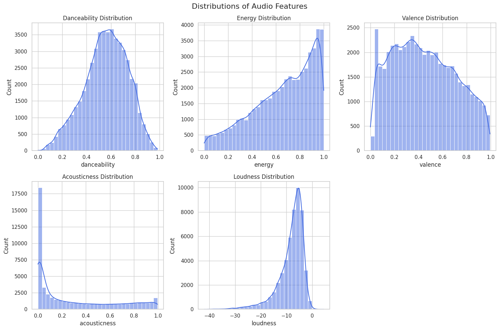
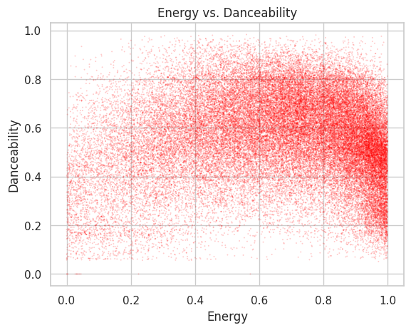
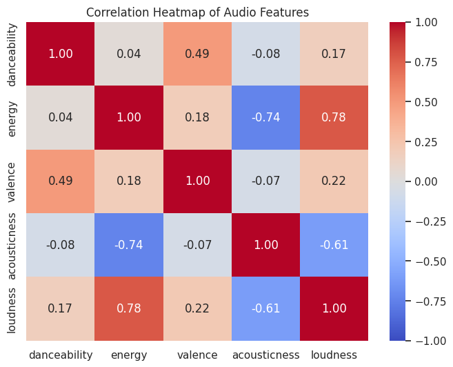

# Audio Features and Mood Patterns

## 1. Objective
This analysis investigates the distributions and relationships of 
specific audio features within the Spotify Tracks dataset. 
The core research questions are:
* How are energy, danceability, and valence distributed across the tracks?
* Which audio features appear mathematically related to one another?
* Do tracks with higher energy generally exhibit higher danceability?

## 2. Dataset and Variables
The analysis utilizes `spotify-tracks-dataset.csv`. To isolate this specific scope,
the dataset was subset to the following variables:
* `track_name` & `artists`: Track identifiers.
* `danceability`: Suitability for dancing based on tempo, rhythm stability, and beat strength (0.0 to 1.0).
* `energy`: Perceptual measure of intensity and activity (0.0 to 1.0).
* `valence`: Musical positiveness conveyed by a track (0.0 to 1.0).
* `acousticness`: Confidence measure of whether the track is acoustic (0.0 to 1.0).
* `loudness`: Overall loudness of a track in decibels (dB).

## 3. Data Preparation
Data cleaning was performed using `pandas` to ensure accurate statistical distributions:
1. **Index Cleanup:** Dropped legacy index artifacts (`Unnamed: 0` and `Unnamed: 0.1`).
2. **Column Isolation:** Filtered the dataframe to only include the relevant audio features required.
3. **Targeted Null Removal:** Removed 1 row missing `track_name` and `artists`. 
4. **Duplicate Removal:** Removed 27,268 exact duplicate rows to prevent artificial skewing of feature histograms.

## 4. Exploratory Data Analysis
Visualizations using `matplotlib` and `seaborn`. 
* **Distributions:** Histograms with Kernel Density Estimation (KDE) overlays were plotted for all five numeric features.
**Feature Distributions**

* **Energy vs. Danceability:** A custom scatter plot to map density dynamically, resolving severe overplotting.
**Energy vs. Danceability Density**

* **Relationships:** A correlation heatmap was generated for all numeric variables.
**Feature Correlation Heatmap**

## 5. Findings
* **Feature Distributions:** Most tracks in the dataset are heavily produced, indicated by the massive spike near zero for acousticness.
Energy and loudness are both skewed toward the higher end of their scales, while danceability follows a fairly normal bell curve centered around 0.6. 

* **Energy and Danceability:** The scatter plot's darkest red cluster sits in the top right,
showing that the majority of songs combine high energy (above 0.6) with mid-to-high danceability. 
You will rarely find a track that has very low energy but high danceability.

* **Correlations:** The heatmap highlights a strong positive link between energy and loudness at 0.76. Conversely, energy and acousticness are strong opposites, with a negative correlation of -0.73. There is also a moderate positive link (0.49) between danceability and valence.

## 6. Limitations
* **Causation Fallacy:** Strong correlations (e.g., between energy and loudness) do not establish that one feature directly causes the other; 
both may be heavily influenced by modern mixing and mastering standards.
* **Dataset Bias:** The dataset includes multiple genres, meaning the distributions represent global averages rather than genre-specific trends.

## 7. Conclusion
Overall, this dataset leans heavily toward loud, energetic, non-acoustic tracks. While having high energy doesn't guarantee a track will be highly danceable, the dense clustering shows they usually go hand-in-hand. The strongest mathematical takeaways confirm common musical intuition: louder tracks are almost always highly energetic, and acoustic tracks almost never are.

