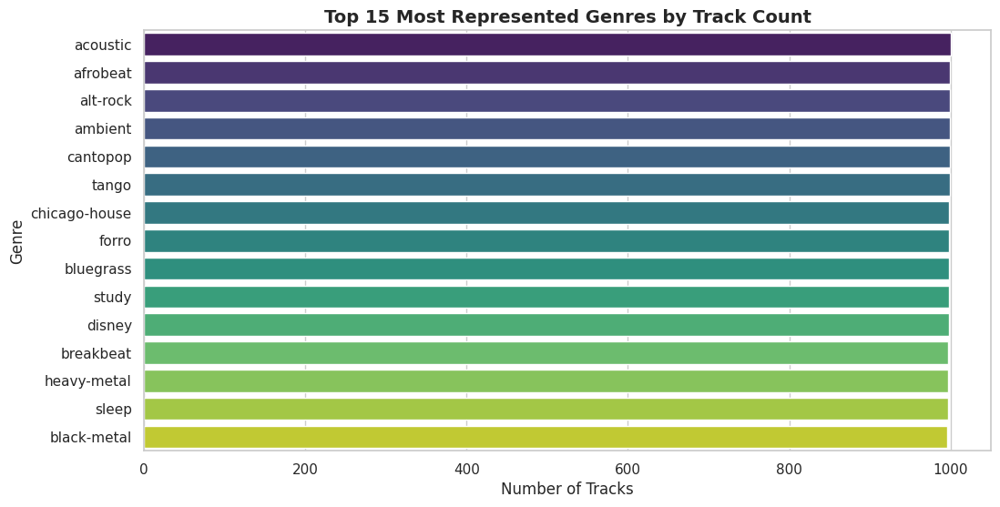
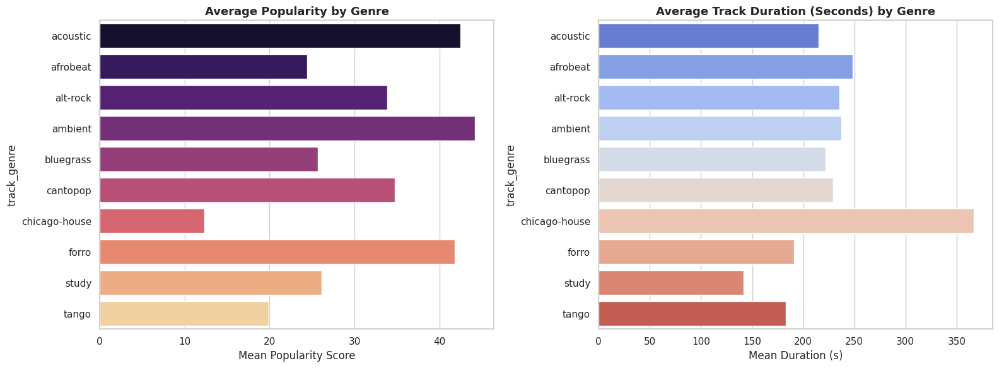
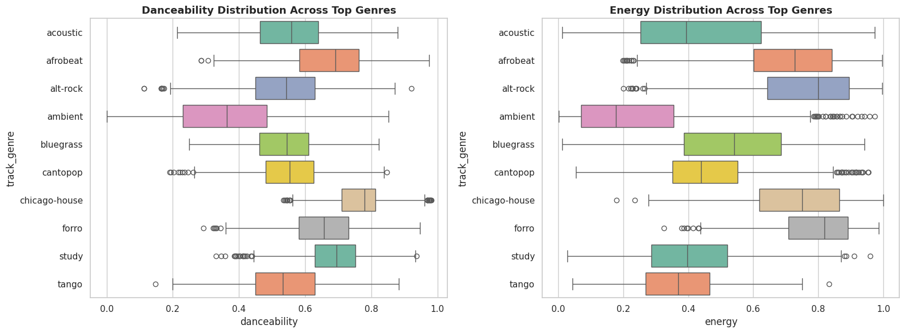

# Member 3: Genre-Based Music Exploration & Spotify Audio Analytics

> **Project:** [The Anatomy of a Hit](https://github.com/RevathiLogs/The-Anatomy-of-a-Hit)  
> **Module:** Genre Representation, Popularity, Duration, and Audio Feature Analysis  
> **Author:** Member 3  

---

## 1. Objective & Dataset Overview

This module delivers a comprehensive, data-driven analysis of **113 unique Spotify genres** and over **122,000 tracks**. The primary objective is to investigate how musical genres differ across core acoustic metrics (*danceability*, *energy*, *track duration*), evaluate baseline platform popularity across subgenres, and explain structural considerations such as sampling bias in music dataset evaluation.

---

## 2. Track Representation Across Genres

The underlying dataset covers **113 distinct genres**. To maintain sampling balance during data collection, most top-tier genres are represented with nearly equal track volumes (~1,000 tracks per genre).

### Top 10 Most Represented Genres

| Rank | Genre | Total Track Count | Data Share (%) |
| :---: | :--- | :---: | :---: |
| **1** | `acoustic` | **1,000** | ~0.82% |
| **2** | `afrobeat` | **999** | ~0.82% |
| **3** | `alt-rock` | **999** | ~0.82% |
| **4** | `ambient` | **999** | ~0.82% |
| **5** | `cantopop` | **999** | ~0.82% |
| **6** | `tango` | **999** | ~0.82% |
| **7** | `chicago-house` | **998** | ~0.82% |
| **8** | `forro` | **998** | ~0.82% |
| **9** | `bluegrass` | **998** | ~0.82% |
| **10** | `study` | **998** | ~0.82% |

---

## 3. Graph 1 Analysis: Top 15 Most Represented Genres



### Detailed Analysis & Insights

1. **Balanced Distribution:**  
   The horizontal bar plot reveals near-perfect parity across the top 15 genres, with each genre hovering between **998 and 1,000 tracks**.
2. **Diverse Genre Representation:**  
   The dataset encompasses a broad spectrum of musical styles—ranging from functional/utility music (`study`, `sleep`, `ambient`) to regional folk styles (`forro`, `tango`, `cantopop`, `bluegrass`) and energetic dance subgenres (`chicago-house`, `afrobeat`).
3. **Analytical Advantage:**  
   Because the track counts among these top categories are practically uniform, direct mean and median comparisons can be drawn without high-volume genres heavily distorting the global distributions.

---

## 4. Graph 2 Analysis: Average Popularity vs. Track Duration by Genre



### Part A: Mean Popularity Score Breakdown (Left Panel)

* **Top Performers:**  
  * **`ambient` (~44.1)** and **`acoustic` (~42.4)** achieve the highest mean popularity scores among the analyzed genres.
  * **`forro` (~41.8)** and **`cantopop` (~34.8)** also maintain strong baseline popularity on streaming platforms.
* **Underperformers:**  
  * **`chicago-house` (~12.3)** registers the lowest average popularity score, indicating that niche electronic subgenres cater to specialized audiences rather than driving mass-market commercial streams.
  * **`tango` (~19.8)** and **`bluegrass` (~25.6)** similarly exhibit lower baseline platform popularity.

### Part B: Mean Track Duration Breakdown (Right Panel)

* **Longest Tracks:**  
  * **`chicago-house`** leads significantly, averaging **over 365 seconds (~6.1 minutes)** per track. Electronic dance genres frequently feature extended intros and outro sections designed for DJ blending.
  * **`afrobeat` (~248 seconds / 4.1 minutes)** and **`ambient` (~236 seconds / 3.9 minutes)** also lean toward longer compositions.
* **Shortest Tracks:**  
  * **`study` tracks** feature the shortest average length at **~140 seconds (~2.3 minutes)**, reflecting modern streaming trends where background/functional tracks are kept brief to maximize playback loops and repeat stream counts.

---

## 5. Graph 3 Analysis: Audio Feature Distributions (Danceability & Energy)



### Part A: Danceability Distribution (Left Box Plot)

* **Highest Danceability:**  
  * **`chicago-house`** displays the highest median danceability score (**~0.75**), featuring a tight interquartile range (IQR) concentrated between `0.70` and `0.81`.
  * **`study` (~0.70 median)** and **`forro` (~0.61 median)** also show high rhythmic regularity conducive to dancing or focused movement.
* **Lowest Danceability & High Dispersion:**  
  * **`ambient`** registers the lowest median danceability (**~0.36**) with an exceptionally wide IQR spanning from `0.23` to `0.48`. Because ambient music lacks structured drum signatures, rhythm-based metrics drop significantly.

### Part B: Energy Distribution (Right Box Plot)

* **Highest Energy:**  
  * **`alt-rock`** and **`forro`** exhibit the highest median energy levels (**~0.80–0.83**), driven by heavily amplified instrumentation, prominent percussive elements, and high dynamic loudness.
  * **`chicago-house` (~0.75 median)** also scores high in acoustic intensity.
* **Lowest Energy:**  
  * **`ambient`** displays the lowest overall energy profile (**~0.18 median**), aligning with its intended purpose as soothing, low-intensity background audio.

---

## 6. Methodological Note: Handling Uneven Track Counts

> **Critical Analytical Consideration:**  
> While the sample selected for these visualizations is well-balanced, real-world music datasets frequently contain severe class imbalances across genres.

1. **Sampling Bias in Unbalanced Datasets:**  
   Genres with tens of thousands of tracks yield statistically stable parameter estimates. Conversely, small niche genres with only a few dozen tracks are easily skewed by outlier tracks.
2. **Mitigation Strategy:**  
   When performing cross-genre comparative benchmarking, analysts should utilize **normalized sampling**, evaluate **medians and IQRs alongside means**, or weight group statistics by total category volume to prevent skewed conclusions.

---

## 7. Python Implementation Snapshot

```python
import matplotlib.pyplot as plt
import seaborn as sns

# Setup Plot Theme
sns.set_theme(style="whitegrid")

# Compare Danceability & Energy across Top Genres via Boxplots
fig, axes = plt.subplots(1, 2, figsize=(16, 6))

# Boxplot for Danceability
sns.boxplot(data=filtered_df, x="danceability", y="track_genre", ax=axes[0], palette="Set2")
axes[0].set_title("Danceability Distribution Across Top Genres", fontsize=13, fontweight="bold")
axes[0].set_xlabel("Danceability Score (0.0 - 1.0)")

# Boxplot for Energy
sns.boxplot(data=filtered_df, x="energy", y="track_genre", ax=axes[1], palette="Set2")
axes[1].set_title("Energy Distribution Across Top Genres", fontsize=13, fontweight="bold")
axes[1].set_xlabel("Energy Score (0.0 - 1.0)")

plt.tight_layout()
plt.show()
